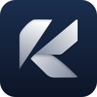

<p align="center">
  <a href="https://github.com/ramsyallf/kritika-ai">
    
  </a>
</p>

<h1 align="center">KRITIKA AI</h1>

<p align="center">
  <strong>Platform Pembelajaran Transformatif & Berpikir Kritis Berbasis AI Sokratik untuk Analisis Regresi</strong>
</p>

<p align="center">
  <em>Dikembangkan untuk Program Riset Pembelajaran Transformatif (SATRIA) — Departemen Statistika Bisnis, Fakultas Vokasi, Institut Teknologi Sepuluh Nopember (ITS) Surabaya.</em>
</p>

<p align="center">
  <a href="https://nextjs.org"></a>
  <a href="https://react.dev"></a>
  <a href="https://www.typescriptlang.org"></a>
  <a href="https://tailwindcss.com"></a>
  <a href="https://eslint.org"></a>
  <a href="#"></a>
</p>

<p align="center">
  <a href="#-tentang-kritika-ai">Tentang</a> •
  <a href="#-metodologi-pedagogis-enam-sintaks">Metodologi</a> •
  <a href="#-fitur-unggulan">Fitur Utama</a> •
  <a href="#-sistem-desain">Sistem Desain</a> •
  <a href="#-arsitektur-rute">Arsitektur Rute</a> •
  <a href="#-struktur-direktori">Struktur Direktori</a> •
  <a href="#-panduan-instalasi--pengembangan">Memulai</a> •
  <a href="#-tim-peneliti">Tim Peneliti</a>
</p>

---

## 💡 Tentang KRITIKA AI

Kehadiran *Generative AI* sering kali memicu fenomena **"Cognitive Offloading"** di kalangan mahasiswa—di mana mahasiswa cenderung langsung menyalin luaran AI tanpa menguji validitas asumsi statistik, mengevaluasi multikolinearitas, atau memahami konsekuensi praktis dari model prediktif.

**KRITIKA AI** hadir mendefinisikan ulang interaksi mahasiswa dengan kecerdasan buatan melalui pendekatan **Transformative Socratic Learning**. Alih-alih menjadi mesin penjawab instan, KRITIKA AI berperan sebagai **Mitra Dialog Sokratik** yang menantang asumsi, menguji penalaran matematis, mengekspos kekeliruan analisis, serta menuntut mahasiswa menyusun argumentasi berbasis bukti statistik (*empirical evidence-based reasoning*).

Platform ini dirancang khusus untuk mata kuliah **Metode Regresi / Teknik Regresi** (Program Studi D4 Analitika Logistik Terapan & Sarjana Terapan Statistika Bisnis ITS).

---

## 🧬 Metodologi Pedagogis: Enam Sintaks dalam Empat Fase

Arsitektur pembelajaran KRITIKA AI mengimplementasikan siklus **Enam Sintaks Pembelajaran Transformatif** yang terbagi ke dalam **Empat Fase Progresif**:

```
┌─────────────────┐       ┌──────────────────────────────┐       ┌──────────────────────────────┐       ┌────────────────────────────────┐
│   1. TRIGGER    │  ───▶ │        2. REFLECTION         │  ───▶ │          3. ACTION           │  ───▶ │        4. INTEGRATION          │
├─────────────────┤       ├──────────────────────────────┤       ├──────────────────────────────┤       ├────────────────────────────────┤
│ Sintaks 1:      │       │ Sintaks 2: Dialog AI         │       │ Sintaks 4: Tantangan Baru    │       │ Sintaks 6: Refleksi Akhir      │
│ Pemicu Kritis   │       │ Sintaks 3: Refleksi Antara   │       │ Sintaks 5: Asesmen Mandiri   │       │ & Integrasi Pembelajaran       │
│ (Mandiri tanpa  │       │ (Uji Asumsi, Investigasi     │       │ (Olah Data OLS, Uji IIDN,    │       │ (Portofolio Digital, Radar     │
│  bantuan AI)    │       │  Argumen & Mispersepsi AI)   │       │  Anti-Cheat & No-AI Guard)   │       │  Facione & Transfer Konsep)    │
└─────────────────┘       └──────────────────────────────┘       └──────────────────────────────┘       └────────────────────────────────┘
```

### Rincian Sintaks K–R–I–T–I–K–A:
1. **Sintaks 1: Pemicu Kritis (`K–R`)** — Mahasiswa mengkaji dilema bisnis nyata (studi kasus regresi distribusi multi-wilayah) dan menyusun hipotesis awal secara mandiri tanpa intervensi AI.
2. **Sintaks 2: Dialog & Investigasi AI (`I`)** — Dialog kritis terpandu bersama AI Mentor Sokratik. Mahasiswa menguji asumsi statistik dan mengidentifikasi bias keluaran AI.
3. **Sintaks 3: Refleksi Antara (`T`)** — Mahasiswa mengomparasikan pemahaman awal vs temuan baru melalui 3 indikator refleksi wajib: *(1) Asumsi awal?, (2) Temuan baru?, (3) Perubahan pemahaman?*
4. **Sintaks 4: Tantangan Kasus Baru (`I`)** — Platform menyajikan studi kasus baru beserta dataset bisnis tervalidasi dosen pengampu untuk menguji ketahanan pemahaman konsep.
5. **Sintaks 5: Asesmen Mandiri Tanpa Gen-AI (`K`)** — Lingkungan asesmen steril tanpa akses bot AI. Mahasiswa melakukan estimasi OLS, uji diagnostik residual, dan perumusan model terbaik.
6. **Sintaks 6: Refleksi Akhir & Integrasi (`A`)** — Mahasiswa mendokumentasikan portofolio kognitif: *(1) Perubahan perspektif, (2) Prinsip berpikir kritis, (3) Strategi masa depan, (4) Transfer pembelajaran pada kasus nyata*.

---

## ✨ Fitur Unggulan Platform

### 1. 🤖 AI Mentor Sokratik Studio (`/student/mentor`)
- **Taksonomi Pertanyaan Paul & Elder:** AI mengimplementasikan 5 variasi pertanyaan kritis: *Clarifying Question*, *Challenging Assumptions*, *Requesting Statistical Evidence*, *Counterargument*, dan *Reflective Questioning*.
- **Pedagogical Guardrails:** AI secara ketat dilarang membocorkan jawaban akhir; seluruh interaksi didesain mengarahkan mahasiswa menemukan kekeliruan berpikirnya sendiri.
- **Inspector Panel Kontekstual:** Menampilkan target CPMK, data diagnostik aktif (misal $R^2 = 0{,}914$, $\text{VIF} = 11{,}42$, $p = 0{,}003$), serta progres capaian dimensi berpikir kritis secara real-time.

### 2. 📊 Statistical Workspace ala Apple Numbers (`/student/workspace`)
- **Integrated Empirical Analysis:** Tabular dataset viewer, konfigurasi pemodelan OLS instan, tabel estimasi parameter ($\beta_0, \beta_1, \beta_2$), standar eror robust HC3, $t$-statistic, serta $p$-value.
- **Uji Diagnostik Asumsi Klasik (IIDN):** Multikolinearitas (VIF), Heteroskedastisitas (Breusch-Pagan Test), Normalitas Residual (Shapiro-Wilk Test), dan Autokorelasi (Durbin-Watson Test).
- **Interactive Recharts Visualization:** Plot scatter regresi linear, kurva distribusi residual, dan plot diagnostik residual vs fitted value.

### 3. 🛡️ Lingkungan Asesmen Mandiri Berintegritas Tinggi (`/student/assessment`)
- **Tiga Kolom Terpadu (Sesuai Gambar 2.1 Proposal):** Kolom 1 (*Dataset* $X_1, X_2, Y$), Kolom 2 (*Analisis Statistik & Checklist Uji Asumsi*), dan Kolom 3 (*Formulir Argumentasi Berbasis Bukti* dengan batas karakter `0/2000`).
- **Anti Copy–Paste Engine:** Menolak aksi `copy`, `paste`, dan `cut` pada lembar asesmen demi menjaga orisinalitas analisis.
- **Audit Telemetri Aktivitas Tab:** Melacak dan mencatat stempel waktu setiap kali mahasiswa beralih tab peramban atau meminimalkan jendela ujian.
- **Deteksi Otomatis Indikasi Kecurangan:** Penandaan (*flagging*) otomatis atas perilaku tidak wajar yang langsung diteruskan ke dasbor dosen pengampu.

### 4. 📈 Portofolio Digital & Pengukuran 5 Dimensi Facione (`/student/portfolio`)
- **Radar Chart Berpikir Kritis:** Evaluasi visual pada lima dimensi kognitif Facione (1990): *Interpretasi*, *Analisis*, *Evaluasi*, *Inferensi*, dan *Regulasi Diri*.
- **Longitudinal Cognitive Gain:** Pelacakan efektivitas pembelajaran melalui kalkulasi $N\text{-Gain}$ kognitif pre-test vs post-test.
- **Ekspor Dokumen Refleksi:** Menghasilkan ringkasan portofolio komprehensif siap unduh.

### 5. 👨‍🏫 Sistem Operasi Dosen & Human-in-the-Loop (`/lecturer/*`)
- **Generator Kasus Berbasis Gen-AI & Validasi Dosen:** Generator studi kasus regresi berbasis AI yang wajib divalidasi dan dikurasi oleh dosen pengampu sebelum didistribusikan ke bank soal mahasiswa.
- **Monitoring Kohort 40 Mahasiswa:** Pemantauan real-time progres 6 sintaks tiap mahasiswa, metrik N-Gain individu, serta audit log integritas ujian.
- **Manajemen Pembobotan Penilaian Sesuai Proposal:** Formula otomatis (Refleksi Antara & Akhir 25%, Asesmen Mandiri 40%, Portofolio Digital 20%, Partisipasi Dialog AI 15%).
- **Komparasi Statistik Kohort:** Visualisasi perbandingan pre vs post serta pengujian signifikansi (Paired $t$-test & Wilcoxon).

---

## 🎨 Sistem Desain (Apple Human Interface Guidelines)

KRITIKA AI mengadopsi prinsip desain **Apple macOS / iPadOS & Linear**:

| Token Warna | Nilai HEX | Peruntukan UI |
| :--- | :--- | :--- |
| **Primary Navy** | `#102A56` | Identitas brand utama, active state, dan visual emphasis |
| **Deep Navy** | `#0B1B36` | Tipografi heading primer, logo badge, dan kontras tinggi |
| **Primary Blue** | `#2563EB` | Aksen tombol utama, progress bar, dan status aktif |
| **Accent Blue** | `#4F8CFF` | Sorotan visual data dan gradien sekunder |
| **Soft Blue** | `#EAF2FF` | Surface pill, badge latar, dan container aktif |
| **Main Canvas** | `#F7F9FC` | Latar belakang kanvas aplikasi |
| **Card Surface** | `#FFFFFF` | Kontainer kartu, bento grid, dan modal dialog |
| **Primary Text** | `#172033` | Teks tubuh utama dan label input |
| **Secondary Text** | `#718096` | Teks pendukung, metadata, dan deskripsi subtitel |
| **Thin Border** | `#E5EAF2` | Garis batas tipis 1px subtil |

---

## 🧭 Arsitektur Rute

```
kritika-ai/
├── (auth)/
│   ├── /login                 # Halaman autentikasi institusional (Preset Mahasiswa & Dosen)
│   └── /forgot-password       # Alur pemulihan kata sandi akademik
│
├── student/                   # PORTAL MAHASISWA
│   ├── /dashboard             # Ringkasan siklus transformatif, 4 peran platform, & metrik Facione
│   ├── /classes               # Daftar kelas aktif, silabus CPMK, & pustaka rujukan
│   ├── /learning              # Meja kerja interaktif 6 Sintaks & Refleksi Antara
│   ├── /mentor                # Studio dialog sokratik AI Mentor dengan inspector panel
│   ├── /workspace             # Workspace analisis regresi OLS & uji asumsi residual
│   ├── /assessment            # Asesmen mandiri 3-kolom terintegrasi (Anti-Cheat & No-AI Guard)
│   └── /portfolio             # Portofolio longitudinal refleksi akhir & radar 5 dimensi Facione
│
└── lecturer/                  # PORTAL DOSEN PENGAMPU
    ├── /dashboard             # Dasbor pemantauan kohort 40 mahasiswa & analitik sintaks
    ├── /classes               # Manajemen kelas perkuliahan & modal pembuatan kohort
    ├── /topics                # Pemetaan topik kurikulum, CPMK, & target miskonsepsi
    ├── /cases                 # AI Case Generator & alur validasi kurasi dosen
    ├── /question-bank         # Repositori bank soal tervalidasi dengan filter & modal CRUD
    ├── /students              # Direktori mahasiswa, linimasa aktivitas, & drawer evaluasi kualitatif
    ├── /assessments           # Manajemen penilaian berbobot proposal & rubrik holistik Facione
    └── /analytics             # Rekapitulasi N-Gain, uji hipotesis pre-post, & capaian dimensi
```

---

## 📁 Struktur Direktori

```
kritika-ai/
├── public/
│   └── logo.svg               # Aset vektor resmi KRITIKA AI
├── src/
│   ├── app/                   # Next.js App Router (Halaman & Layout)
│   │   ├── (auth)/            # Halaman otentikasi
│   │   ├── student/           # Rute portal mahasiswa
│   │   ├── lecturer/          # Rute portal dosen
│   │   ├── globals.css        # Tailwind CSS v4 & variabel tema
│   │   ├── layout.tsx         # Root layout dengan font Geist & metadata favicon
│   │   ├── icon.svg           # Dynamic App Router favicon
│   │   └── not-found.tsx      # Halaman 404 berdesain Apple
│   │
│   ├── components/
│   │   ├── layout/            # Shell aplikasi (Sidebar Vibrancy & Translucent Topbar)
│   │   ├── shared/            # Modal drawer evaluasi mahasiswa (Facione Rubric)
│   │   └── ui/                # Apple-grade primitives, overlays, & KritikaLogo
│   │
│   ├── lib/
│   │   ├── ai-mentor-service.ts    # Abstraksi dialog sokratik & guardrail pedagogis
│   │   ├── stats-engine-service.ts # Mesin kalkulasi OLS regresi & uji diagnostik IIDN
│   │   ├── store.tsx               # Reactive State Management dengan sinkronisasi Storage
│   │   └── utils.ts                # Helper format angka, p-value, generator ID & cn
│   │
│   ├── mock-data/             # Dataset realistis Metode Regresi & 40 mahasiswa ITS
│   └── types/                 # Definisi tipe TypeScript domain komprehensif
│
├── eslint.config.mjs          # Konfigurasi ESLint 9 Flat Config
├── next.config.mjs            # Konfigurasi Next.js 15
├── package.json               # Dependensi & skrip pengembangan
├── tsconfig.json              # Konfigurasi TypeScript ketat
└── README.md                  # Dokumentasi resmi repositori
```

---

## 🚀 Panduan Instalasi & Pengembangan

### Prasyarat
- **Node.js**: v18.18.0 atau lebih baru (disarankan v20 LTS)
- **Package Manager**: `npm`, `pnpm`, atau `yarn`

### 1. Kloning Repositori
```bash
git clone https://github.com/ramsyallf/kritika-ai.git
cd kritika-ai
```

### 2. Instalasi Dependensi
```bash
npm install
```

### 3. Menjalankan Server Pengembangan
```bash
npm run dev
```
Buka [http://localhost:3000](http://localhost:3000) di peramban Anda. Akun preset demo tersedia di halaman login:
- **Akun Mahasiswa:** `raka.pratama@student.its.ac.id` (Kata sandi: `kritika2026`)
- **Akun Dosen:** `iis.dewi@statistika.its.ac.id` (Kata sandi: `kritika2026`)

### 4. Skrip Pengecekan Kualitas Kode
```bash
# Pengecekan tipe statis (TypeScript strict)
npm run typecheck

# Audit linting menyeluruh (ESLint 9)
npm run lint

# Kompilasi build produksi Next.js
npm run build

# Menjalankan build produksi secara lokal
npm run start
```

---

## 👥 Tim Peneliti & Pengembang

Proyek riset dan pengembangan platform ini berada di bawah naungan **Program SATRIA (Saintek Riset Pembelajaran Transformatif)**:

- **Ketua Peneliti:** Dr. Iis Dewi Ratih, S.Si., M.Si.
- **Anggota Peneliti:** 
  - Noviyanti Santoso, S.Si., M.Si., Ph.D.
  - Albertus Eka Putra Haryanto, S.Tr.Stat., M.Stat.
- **Institusi Penyelenggara:** Departemen Statistika Bisnis, Fakultas Vokasi, Institut Teknologi Sepuluh Nopember (ITS), Surabaya.

---

## 📄 Lisensi & Hak Kekayaan Intelektual

Hak Cipta © 2026 Tim Peneliti KRITIKA AI — Institut Teknologi Sepuluh Nopember (ITS). Seluruh hak cipta dilindungi undang-undang.
